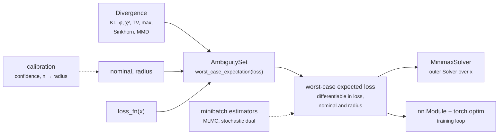

# Mathematical formulations and design

This page collects the mathematical background and the design rationale of
the distributionally robust optimization (DRO) core in `optora`. It states
the problem `optora` solves, the convex duals behind each ambiguity set,
and the design principles the public API follows. The root `README.md` is
kept short and code-first on purpose, so the derivations live here. The
[Tutorials](tutorials/index.md) walk through the runnable scripts under
`tutorials/` in the repository, which exercise this math end to end with
plots, and the [Examples](examples/index.md) show each component on its
own in a short script. Every figure on this page is rendered from the library when the
site is built.

## Why distributionally robust optimization

Empirical risk minimization (ERM) minimizes the average loss over the
training data, which assumes that the empirical distribution is a faithful
picture of the distribution we care about. That assumption often fails. The
sample may be small, the population may shift after the data are
collected, or an adversary may perturb the inputs. DRO replaces the
expectation under the nominal distribution by the largest expectation over
a neighbourhood of it,

$$
\min_x \; \sup_{q \in \mathrm{ambiguity\_set}(\mathrm{nominal}, \mathrm{radius})} \mathbb{E}_q[\ell(x, \xi)]
$$

The neighbourhood, called the *ambiguity set*, contains every candidate
distribution $q$ whose divergence $D$ from the nominal (reference)
distribution is at most a chosen radius,

$$
\mathrm{ambiguity\_set}(\mathrm{nominal}, \mathrm{radius}) = \{\, q : D(q \,\|\, \mathrm{nominal}) \le \mathrm{radius} \,\}
$$

The architecture of Optora follows this formula directly. A `Divergence` is
$D$, an `AmbiguitySet` bundles a `Divergence` with a `nominal` distribution
and a `radius`, and a `Solver` carries out the numerical work, either
finding the worst case or, one level up, solving the full minimax problem
over the decision and the distribution.

The shape of the neighbourhood is the main modelling decision. On a
three-scenario simplex, each ambiguity set in Optora is a different region
around the same nominal distribution, and each sends the adversary to a
different worst case for the same loss.

<figure class="figure" markdown="span">
  { loading=lazy }
  { loading=lazy }
  <figcaption>Each panel shows the set of distributions inside one ball
  around the nominal (grey dot), at forty percent of the radius at which the
  ball first contains the point mass on the highest loss. The coloured dot
  is the worst-case distribution, and the line is its path from the
  nominal. The $\varphi$-divergence balls (KL, chi-square, total variation,
  CVaR) only reweight the nominal, so they never put mass on a scenario the
  nominal gives none. The transport and kernel balls (Wasserstein, Sinkhorn,
  MMD) have no such restriction.</figcaption>
</figure>

## Core abstractions

| Contract | Location | Responsibility |
| --- | --- | --- |
| `Divergence` | `optora.core.divergence_base` | Callable `forward(p, q) -> Tensor` that computes a nonnegative discrepancy between two distributions and vanishes at its centre. The centre is `p == q` for every divergence except `EntropicTransportDivergence`, whose centre is the kernel-smoothed reference. |
| `AmbiguitySet` | `optora.core.dro_base` | Holds a `nominal` distribution, a `Divergence`, and a `radius`, and requires subclasses to implement `worst_case_expectation(loss) -> Tensor`. |
| `Solver[ProblemT, ResultT]` | `optora.core.solver_base` | Generic numerical method with a single `solve(problem) -> result` method. Each problem class, such as unconstrained minimization, has its own problem and result dataclasses instead of one signature shared by every algorithm. |

The pieces compose in one direction. A divergence gives an ambiguity set
its geometry. The ambiguity set turns a per-scenario loss into a worst-case
expectation, which a solver, a `torch.optim` optimizer or `MinimaxSolver`
then minimizes over the decision.

## Formulations implemented today

Every ambiguity set below reduces the inner supremum over candidate
distributions $q$ to a tractable problem, namely a scalar search along a
maximizer of known shape, a closed form, or, for MMD, a second-order cone
program. None of them searches the full space of candidate distributions.
The animation below grows every ball from the nominal to its saturation
radius and shows how each geometry spends the budget.

<figure class="figure" markdown="span">
  { loading=lazy }
  { loading=lazy }
  <figcaption>Every ball is drawn at the same fraction of its own saturation
  radius. The worst-case distribution is obtained from autograd as the
  gradient of the worst-case expectation, and the last panel shows the value
  every set reports.</figcaption>
</figure>

### `KLAmbiguitySet`

The KL ball. The inner supremum has a classical one-dimensional convex dual
(Hu and Hong, 2013; Ben-Tal et al., 2013).

$$
\sup_{q:\, D_{\mathrm{KL}}(q \,\|\, \mathrm{nominal}) \,\le\, \mathrm{radius}} \mathbb{E}_q[\mathrm{loss}]
= \inf_{\eta > 0} \; \eta \cdot \mathrm{radius}
    + \eta \log \mathbb{E}_{\mathrm{nominal}}\!\left[\exp\!\left(\frac{\mathrm{loss}}{\eta}\right)\right]
$$

Optora evaluates it from the primal side instead. The KKT conditions of the
primal problem make the maximizer an exponential (Gibbs) tilt of the
nominal,

$$
q_\beta \propto \mathrm{nominal} \cdot e^{\beta\,\mathrm{loss}},
    \qquad \beta = 1/\eta \ge 0,
$$

so the problem reduces to choosing one scalar. A float `radius` of zero
returns $\mathbb{E}_{\mathrm{nominal}}[\mathrm{loss}]$ exactly and skips the
search.

<figure class="figure" markdown="span">
  { loading=lazy }
  { loading=lazy }
  <figcaption>The left panel shows the nominal (grey) and the tilted worst
  case $q_\beta$ on twelve scenarios, ordered by position and labelled with
  their losses. The right panel shows the worst-case expectation against the
  radius. It rises from the nominal expectation to the maximum loss, which
  it reaches exactly at saturation.</figcaption>
</figure>

### Tilt-solved sets and the bracketed scalar search

`KLAmbiguitySet` and `ChiSquareAmbiguitySet` share one mechanism,
implemented once in `optora.core.dro_base.TiltedAmbiguitySet`, which the
exact path of `PhiAmbiguitySet` and `SinkhornAmbiguitySet` below also use.
For both sets the maximizer has a known shape, a one-parameter *tilt* $q_t$
of the nominal that starts at the nominal itself. Along the tilt, the
divergence $D(q_t \,\|\, \mathrm{nominal})$ increases monotonically up to
the divergence of the distribution concentrated on the highest-loss
scenarios. Choosing the tilt is therefore a monotone scalar root-finding
problem, which optora solves by bisection.

**The bracket is valid by construction.** The tilt is parameterized by
$t \in [0,1)$ and mapped to the unbounded natural parameter by
$t \mapsto t/(1-t)$. The interval $[0, 1]$ then brackets the solution for
every loss and every radius. Direct minimization of the dual has no such
guarantee, because its minimizer diverges, $\eta \to \infty$, as the radius
vanishes, and does not exist once the radius saturates the set.

**The result is feasible.** Each step keeps the largest tilt that satisfied
the radius constraint, so the reported value is
$\mathbb{E}_{q^\star}[\mathrm{loss}]$ at a distribution inside the set. It
never exceeds $\max\ell$ and is never `nan`, whatever the support size or
the loss scale.

**The number of steps is fixed and the solve never synchronizes.** The
resolution is read off the dtype (52 bits in float64, 23 in float32), so a
solve is a fixed sequence of device-side kernels with no convergence flag
to read back and no tolerance to tune. A small problem, whose cost is
dominated by kernel launches rather than arithmetic, tests up to 15 evenly
spaced tilts per step in one batched call and so needs a quarter of the
steps. A large problem bisects. Size here means the number of entries in
one tilt evaluation, so a Sinkhorn set, whose tilt reweights all $n$ kernel
rows, counts $n^2$ entries per batch element rather than $n$.

**Saturation needs no special case.** Once the radius reaches
$-\log P^\star$ (KL) or $1/P^\star - 1$ (chi-square), where $P^\star$ is
the nominal mass on the highest-loss scenarios, every tilt is feasible and
the bisection drives $t$ to the top of the bracket. The tilted distribution
$q_t$ is then the nominal restricted to those scenarios and renormalized,
the value is exactly $\max\ell$, and the gradient is that distribution.

Here and below, $\max\ell$ and $\min\ell$ range over the support of the
nominal only. Both divergences are infinite off the support, and every tilt
reweights the nominal, so a scenario with zero nominal mass is unreachable
however large its loss or the radius.

**The tilt is computed on a standardized loss.** The set of candidate
distributions does not depend on `loss`, so for $a > 0$

$$
\sup_q \mathbb{E}_q[a\,\ell + b] = a \sup_q \mathbb{E}_q[\ell] + b .
$$

An affine rescaling of the loss therefore leaves the maximizer unchanged.
Optora computes the tilt from the standardized shortfall
$(\max\ell - \ell)/(\max\ell - \min\ell) \in [0, 1]$ with a detached shift
and scale, and minimizing the expected shortfall is the same as maximizing
the expected loss. Values and gradients are unchanged, and only the
numerical conditioning improves.

!!! note "Gradients come from Danskin's theorem, not from the bisection"
    $\sup_{q \in \mathcal{U}} \mathbb{E}_q[\ell]$ is the support function
    of $\mathcal{U}$ evaluated at $\ell$, so its gradient is the maximizer
    $q^\star$, and a subgradient where the maximizer is not unique. Optora
    reports the value as `sum(q*.detach() * loss)`, so the backward pass is
    exact and the bisection never enters the autograd graph.

### `PhiAmbiguitySet`, `ChiSquareAmbiguitySet`, `TotalVariationAmbiguitySet`, `CVaRAmbiguitySet`

This section covers the general phi-divergence ball and three named
instances. `PhiAmbiguitySet` generalizes the KL dual above to any
phi-divergence (Ben-Tal et al., 2013; Duchi, Glynn, and Namkoong, 2021;
Duchi and Namkoong, 2021) by adding a second dual variable `lam`, which
gives

$$
\sup_{q:\, D_\phi(q \,\|\, \mathrm{nominal}) \,\le\, \mathrm{radius}} \mathbb{E}_q[\mathrm{loss}]
= \inf_{\substack{\eta > 0 \\ \lambda}} \;
    \eta \cdot \mathrm{radius} + \lambda
    + \eta \, \mathbb{E}_{\mathrm{nominal}}\!\left[\phi^*\!\left(\frac{\mathrm{loss} - \lambda}{\eta}\right)\right]
$$

where $\phi^*$ is the convex conjugate of $\phi$. By the KKT conditions,
the maximizer is
$q_i = \mathrm{nominal}_i \, (\phi^*)'(\mu - a\,\mathrm{gap}_i)$, where
$\mathrm{gap}$ is the standardized shortfall defined above, $a = 1/\eta$ is
a rate, and $\mu$ is the level that normalizes $q$. By Fenchel's equality,
the optimality condition of the dual in $\eta$ reads
$\mathbb{E}_{\mathrm{nominal}}[\phi(q / \mathrm{nominal})] =
\mathrm{radius}$. Without a `dual_solver`, `PhiAmbiguitySet` therefore
solves any generator exactly with the same bracketed bisection as the KL
and chi-square sets, with an outer search over the rate and an inner search
over the level. It needs only `phi` and `phi_conjugate`, which it
differentiates with autograd, and `phi_conjugate` must be finite on the
whole real line. The tests check the Cressie-Read family, for example,
against an independent minimization of the dual. The nested search is
slower than the dedicated sets, so prefer those for their own generators.
Passing a `dual_solver` minimizes the dual above instead, with that
solver's accuracy.

<figure class="figure" markdown="span">
  { loading=lazy }
  { loading=lazy }
  <figcaption>The left panel shows the generator $\varphi(t)$, which prices
  reweighting a scenario by the likelihood ratio $t$. The CVaR generator is
  zero up to $1/\alpha$ and infinite beyond. The right panel shows the
  conjugates that enter the dual, computed by
  <code>optora.dro.kl_conjugate</code>, <code>chi_square_conjugate</code>
  and <code>cvar_conjugate</code>.</figcaption>
</figure>

!!! warning "With a `dual_solver`, step sizes are relative to a unit-spread loss"
    The dual is minimized on the standardized loss, so a step size means
    the same thing at every loss scale. It is of order one (up to about 2)
    for a KL-like generator and smaller for a stiffer one, at most about 0.3
    for chi-square. A step size tuned on a raw loss with spread $S$ should
    be multiplied by roughly $S$.

`ChiSquareAmbiguitySet` does not use that dual. Its KKT conditions give a
*linear* tilt truncated at a cut level $c$,

$$
q^\star \propto \mathrm{nominal} \cdot (\mathrm{loss} - c)_+ ,
$$

which the bracketed bisection above pins exactly. When no scenario is
truncated, this reproduces the familiar closed form
$\mathbb{E}_{\mathrm{nominal}}[\ell] + \sqrt{\mathrm{radius} \cdot
\mathrm{Var}_{\mathrm{nominal}}(\ell)}$ (Duchi and Namkoong, 2021). Unlike
that formula, the bisection stays correct once scenarios are truncated to
$q_i = 0$.

The conjugate of the total-variation generator is infinite above a finite
threshold, so neither path of `PhiAmbiguitySet` applies.
`TotalVariationAmbiguitySet` instead computes the worst case from the
closed-form combinatorial solution of the underlying linear program
(Ben-Tal et al., 2013). It sorts the scenarios by loss and moves
probability mass from the lowest-loss scenarios onto the single
highest-loss scenario until the moved mass reaches the radius.

Conditional value-at-risk at tail probability $\alpha \in (0, 1]$, the mean
of the upper $\alpha$-tail of the loss, is the worst case over
distributions whose likelihood ratio to the nominal is at most $1/\alpha$
(Artzner et al., 1999; Rockafellar and Uryasev, 2002).

$$
\mathrm{CVaR}_\alpha(\mathrm{loss})
= \sup_{q:\, q_i \,\le\, \mathrm{nominal}_i / \alpha} \mathbb{E}_q[\mathrm{loss}]
= \inf_{\lambda} \; \lambda
    + \frac{1}{\alpha}\, \mathbb{E}_{\mathrm{nominal}}\big[(\mathrm{loss} - \lambda)_+\big].
$$

This set is the phi-divergence ball of the indicator generator
$\phi_\alpha(t) = 0$ on $[0, 1/\alpha]$ and $+\infty$ elsewhere, whose
conjugate $\phi_\alpha^*(s) = (s)_+/\alpha$ turns the general dual above
into the Rockafellar-Uryasev formula on the right. `CVaRAmbiguitySet`
takes `alpha` directly and represents the same set as the max-divergence
ball

$$
D_\infty(q \,\|\, \mathrm{nominal})
= \log \max_i \frac{q_i}{\mathrm{nominal}_i} \le \log \frac{1}{\alpha},
$$

so its `radius` is $\log(1/\alpha)$ and its `divergence` is
`MaxDivergence`. Like total variation, it does not use the dual. It sorts
the scenarios by loss, gives each its full nominal mass from the top until
the cumulative mass reaches $\alpha$, gives the boundary scenario the
remainder, and divides by $\alpha$. At $\alpha = 1$ the value is the
nominal expectation. The set also accepts $\alpha = 0$, the limit in which
the value is the maximum loss on the support of the nominal.

<figure class="figure" markdown="span">
  { loading=lazy }
  { loading=lazy }
  <figcaption>The left panel shows the scenarios sorted by loss, each as
  wide as its nominal mass. The filled bars are the upper $\alpha$-tail on
  which the worst case concentrates, and the horizontal line is its mean,
  the CVaR. The right panel shows the value as $\alpha$ decreases from
  $\alpha = 1$, where it is the nominal mean, toward $\alpha \to 0$, where it
  approaches the maximum loss.</figcaption>
</figure>

### `WassersteinAmbiguitySet`

The Wasserstein ball, for candidates on the same finite support as the
nominal distribution with a given pairwise ground cost. This case also has
a one-dimensional dual (Mohajerin Esfahani and Kuhn, 2018; Blanchet and
Murthy, 2019; Gao and Kleywegt, 2022).

$$
\sup_{q:\, W_c(q, \mathrm{nominal}) \,\le\, \mathrm{radius}} \mathbb{E}_q[\mathrm{loss}]
= \inf_{\gamma \ge 0} \; \gamma \cdot \mathrm{radius}
    + \mathbb{E}_{\mathrm{nominal}}\!\left[\max_j \big(\mathrm{loss}_j - \gamma \cdot \mathrm{cost}(\cdot, j)\big)\right]
$$

The optimal $\gamma$ can lie exactly on the boundary $\gamma = 0$, which
happens once the radius is large enough to move all the mass to the
highest-loss scenario. The dual is convex but *piecewise linear* in
$\gamma$, so a fixed-step gradient method oscillates around its kink and
does not converge. Its derivative is monotone, so `WassersteinAmbiguitySet`
takes no dual solver. It bisects the sign change of that derivative inside
a closed-form bracket and reaches the exact minimizer in a fixed number of
steps set by the dtype. It uses a `SinkhornDivergence` internally only as
an approximate `contains(...)` membership check. The worst-case
expectation itself is solved exactly, without the entropic approximation.

<figure class="figure" markdown="span">
  { loading=lazy }
  { loading=lazy }
  <figcaption>The left panel shows twelve scenarios on a line with the
  ground cost $|x_i - x_j|$. The worst case moves mass toward the high-loss
  end and pays the transport distance for it. The right panel shows the
  dual objective in $\gamma$ at the current radius, with its minimizer
  $\gamma^\star$, which is the multiplier that <code>radius.grad</code>
  returns.</figcaption>
</figure>

### `SinkhornAmbiguitySet`

Sinkhorn DRO (Wang, Gao, and Xie, 2025) replaces the Wasserstein distance
with its entropic regularization, taken relative to a reference measure
$\nu$ on the support (the counting measure by default). On a finite
support the Sinkhorn ball is a mixture of KL balls with one shared budget,
one ball around each Gibbs kernel row
$Q_i \propto \nu\, e^{-\mathrm{cost}(i, \cdot)/\epsilon}$, which gives

$$
\sup_{\gamma_1, \ldots, \gamma_n}
    \Big\{ \sum_i \mathrm{nominal}_i \, \mathbb{E}_{\gamma_i}[\mathrm{loss}]
    \;:\; \epsilon \sum_i \mathrm{nominal}_i\,
        \mathrm{KL}(\gamma_i \,\|\, Q_i) \le \mathrm{radius} \Big\}
= \inf_{\lambda \ge 0} \; \lambda\, \mathrm{radius}
    + \lambda \epsilon \sum_i \mathrm{nominal}_i
      \log \sum_j Q_{ij}\, e^{\mathrm{loss}_j / (\lambda \epsilon)} .
$$

Every row's maximizer is an exponential tilt of $Q_i$ at one shared
temperature, so the bracketed bisection used for KL pins it exactly.

!!! note "The ball is centred on the smoothed nominal"
    `radius` is the budget in excess of the entropic bias, so a radius of
    zero gives the single distribution $P^0 = \mathrm{nominal}^\top Q$, a
    kernel smoothing of the nominal rather than the nominal itself. The
    worst case can put mass anywhere $\nu$ does, including scenarios with no
    nominal mass. `EntropicTransportDivergence`, which `contains` uses,
    vanishes at $P^0$. It maximizes its semi-dual by Sinkhorn scaling and,
    where Sinkhorn stalls at a sharp kernel (large $\max C/\epsilon$),
    continues with a damped Newton method. It reports the semi-dual value,
    which bounds the divergence from below with an error that is second
    order in the remaining marginal violation.

With a zero cost every row is $\nu$, and the set is the KL ball of radius
$\mathrm{radius}/\epsilon$ around $\nu$. As $\epsilon \to 0$ the dual tends
to the Wasserstein-DRO dual (Wang, Gao, and Xie, 2025). Azizian, Iutzeler,
and Malick (2023) also regularize the objective. That variant returns a
penalized value rather than a worst-case expectation and is not
implemented.

<figure class="figure" markdown="span">
  { loading=lazy }
  { loading=lazy }
  <figcaption>As $\epsilon$ falls, the kernel rows $Q_i$ sharpen toward the
  identity and the smoothed nominal $P^0$ (black step) returns to the
  nominal. At a fixed radius, the Sinkhorn worst case approaches the
  Wasserstein worst case (outlined bars).</figcaption>
</figure>

### `MMDAmbiguitySet`

MMD DRO (Staib and Jegelka, 2019; Zhu et al., 2021) bounds the maximum mean
discrepancy, the distance between kernel mean embeddings, for a positive
semidefinite kernel with Gram matrix $K$ on the support. The worst case is

$$
\sup_{q \in \Delta_n} \Big\{ \mathrm{loss}^\top q \;:\;
    \lVert q - \mathrm{nominal} \rVert_K \le \mathrm{radius} \Big\},
\qquad \lVert v \rVert_K = \sqrt{v^\top K v} .
$$

Like the Wasserstein ball, and unlike a $\varphi$-divergence ball, it
contains distributions that put mass where the nominal has none, at a price
set by the geometry of the kernel.

!!! note "A cone program, solved exactly"
    The constraint $q \ge 0$ couples every scenario through $K$, so no
    scalar bracket pins the maximizer. The closed form
    $\mathrm{loss}^\top \mathrm{nominal} + \mathrm{radius}\,
    \lVert \mathrm{loss} \rVert_{K^{-1}}$ of Staib and Jegelka (2019)
    drops $q \ge 0$ and is therefore only an upper bound on the worst case.
    The set solves the second-order cone program itself with a batched
    primal-dual interior-point method, using Nesterov-Todd scaling and
    Mehrotra's predictor-corrector steps (Nesterov and Todd, 1997;
    Mehrotra, 1992), to a relative duality gap of `tol` ($10^{-10}$ by
    default) on the loss standardized to unit spread. A few tens of
    iterations suffice for supports into the thousands, and each iteration
    factors one $n \times n$ matrix per batch element.

The gradient in `loss` is the maximizer, and a zero-valued term from the
implicit function theorem on the optimality conditions makes the Hessian in
`loss` exact. Derivatives in `nominal` and `radius` are first order and
follow from the envelope theorem, with the radius derivative given by the
multiplier of the radius constraint. The Laplacian kernel
$e^{-\lVert x - y \rVert}$ is a good default. The Gaussian kernel is also
characteristic, but its Gram matrix on clustered points is numerically
singular, and the ball then contains, at zero discrepancy, every
distribution that differs from the nominal along the null space of $K$.

<figure class="figure" markdown="span">
  { loading=lazy }
  { loading=lazy }
  <figcaption>The left panel shows the kernel geometry on twelve support
  points. In the right panel, the closed form that drops $q \ge 0$ grows
  without bound, while the exact cone program bends and meets the maximum
  loss at saturation.</figcaption>
</figure>

### Group DRO with `group_losses` and `OnlineGroupDRO`

Group DRO (Sagawa et al., 2020) places the ambiguity on the mixture of $G$
known groups rather than on individual samples. Let
$\hat R_g = \frac{1}{n_g} \sum_{i:\, g_i = g} \ell_i$ be the group losses
that `group_losses` computes and $p_g = n_g / n$ the group proportions. If
every group has at least one sample, then

$$
\max_{g} \hat R_g
= \sup_{q \in \Delta_G} \sum_g q_g \hat R_g
= \mathrm{CVaR}_0\big(\hat R;\, p\big),
$$

so group DRO needs no new ambiguity set. `CVaRAmbiguitySet(p, alpha=0.0)`
applied to the group losses gives the worst group exactly, and
$\alpha = 1$ gives ERM, since $\sum_g p_g \hat R_g$ is the sample mean. A
KL or $\chi^2$ ball around $p$ gives a softer worst case, which reaches the
worst group at radius $\log(1/p_{g^\star})$ or $1/p_{g^\star} - 1$
respectively. Through `group_losses`, the gradient with respect to the loss
of sample $i$ is $q^\star_{g_i} / n_{g_i}$, so group DRO reweights samples
uniformly within each group.

On minibatches, `OnlineGroupDRO` keeps $q$ as state and updates it by
exponentiated-gradient ascent, $q_g \propto q_g\, e^{\eta \hat\ell_g}$,
with one step per minibatch, alternating with gradient descent on the
model. This is Algorithm 1 of Sagawa et al. (2020), a stochastic mirror
descent-ascent method. On fixed group losses, its $T$-th iterate is the
exponential tilt $q_0 e^{T \eta \ell} / Z$, which is the worst case of the
KL ball around $q_0$ of matching radius. The online weights therefore
follow the KL-DRO worst-case path toward the worst group.

### `MinimaxSolver`

`MinimaxSolver` combines any of the ambiguity sets above with an outer
solver, such as `GradientDescent`, to solve the *full* DRO problem,
including the minimization over the decision variable,

$$
\min_x \; \sup_{q:\, \mathrm{divergence}(q, \mathrm{nominal}) \,\le\, \mathrm{radius}} \mathbb{E}_q[\mathrm{loss\_fn}(x)]
$$

Each ambiguity set above returns a worst-case expectation whose gradient
with respect to `loss` is the maximizer $q^\star$, so `MinimaxSolver` only
has to minimize the ordinary scalar objective
`x -> ambiguity_set.worst_case_expectation(loss_fn(x))`. By the envelope
theorem, the gradient with respect to `x` is correct even though each set
solves its own inner problem without differentiating through the solve.

Every component above is covered by pytest tests that compare against
known closed-form results, independent reference solvers and grid
searches, convergence limits, and monotonicity properties. The whole
package is type-checked under mypy's strict mode.

## Design principles

- **Small, component-oriented public API.** There are no package-level
  workflow dispatchers (`minimize(...)`, `train(...)`) that hide the method
  being studied, so researchers instantiate the exact algorithm they want.
- **Mathematical objects separated from numerical solvers.** A divergence,
  an ambiguity set, and a solver are independent components, and each can
  be reused on its own.
- **Every extension point is subclassable.** `Divergence`, `AmbiguitySet`,
  and `Solver` are abstract base classes, not a closed enumeration. Optora
  ships reference implementations and does not try to cover every method.
- **PyTorch-native and accelerator-friendly.** Results keep the dtype and
  device of their inputs, and the numerical core avoids unnecessary host
  synchronizations and scalar round-trips, which keeps it suitable for GPU
  and batched workloads.
- **Tested against known mathematics.** Every solver and divergence is
  checked against closed-form solutions, convergence limits, or established
  monotonicity properties, in addition to smoke tests.

## Roadmap and future horizon

The scope of Optora is deliberately narrow. It covers ambiguity sets,
divergences, and the minimax solve that connects them, and that core is
complete. Further extensions will be added when a concrete use case needs
them.

- A dedicated risk-functional layer, once more than one risk measure (CVaR,
  entropic risk, and others) has to be built on the worst-case objective.
- Jointly learned ambiguity sets, once the current static ones (fixed
  `nominal`, fixed `radius`) become limiting.
- Causality-constrained DRO for sequential decision problems.

Further out, the roadmap includes stochastic and differentiable-backend
solvers, optimal transport as a first-class object, and reinforcement
learning under model uncertainty.
