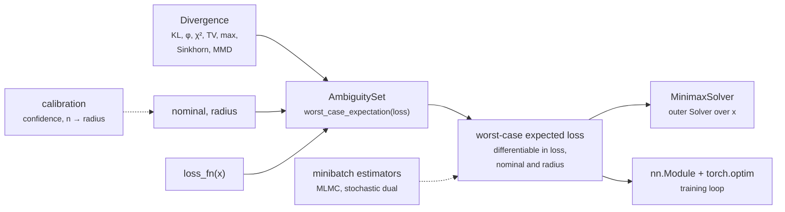

# Mathematical formulations and design

This page holds the full mathematical background and design rationale for
`optora`'s distributionally robust optimization (DRO) core: the problem
`optora` solves, the convex duals underneath each ambiguity set, and the
design principles the public API follows. The root `README.md` stays a
short, code-first landing page on purpose — this page is where the depth
lives. For runnable code that exercises this math end to end, with plots,
see the [Examples](examples/index.md) section, which walks through the
scripts under `examples/` in the repository. Every figure on this page is
rendered from the library when the site is built.

## Why distributionally robust optimization

If you minimize the average loss over your training data (empirical risk
minimization), you're implicitly trusting that your training data is a
faithful picture of the distribution you actually care about. That's often
a shaky assumption — you might have too few samples, the world might have
shifted since you collected the data, or someone might be actively trying
to fool your model. DRO's answer to this is refreshingly blunt: instead of
optimizing against your best guess at the distribution, optimize against
the *worst* distribution within some plausible neighborhood of it.

$$
\min_x \; \sup_{q \in \mathrm{ambiguity\_set}(\mathrm{nominal}, \mathrm{radius})} \mathbb{E}_q[\ell(x, \xi)]
$$

That neighborhood — the *ambiguity set* — is defined by capping some
statistical divergence $D$ between a candidate distribution $q$ and your
nominal (reference) distribution at a radius you choose:

$$
\mathrm{ambiguity\_set}(\mathrm{nominal}, \mathrm{radius}) = \{\, q : D(q \,\|\, \mathrm{nominal}) \le \mathrm{radius} \,\}
$$

Optora's whole architecture is basically this formula, typed out as code: a
`Divergence` is `D`, an `AmbiguitySet` bundles a `Divergence` with a
`nominal` distribution and a `radius`, and a `Solver` does the actual
numerical work of finding the worst case (or, one level up, solving the
full minimax problem over both the decision and the distribution).

The neighbourhood's *shape* is the whole modelling decision. On a
three-scenario simplex, every ambiguity set Optora ships is a different
region around the same nominal distribution, and sends the adversary to a
different worst case for the same loss:

<figure class="figure" markdown="span">
  { loading=lazy }
  { loading=lazy }
  <figcaption>Each panel is the set of distributions within one ball of the
  nominal (grey dot), at forty percent of the radius at which the ball first
  contains the point mass on the highest loss. The coloured dot is the
  worst-case distribution, the line its path from the nominal. The
  $\varphi$-divergence balls (KL, chi-square, total variation, CVaR) are
  cut off where a scenario would need mass the nominal does not have;
  the transport and kernel balls (Wasserstein, Sinkhorn, MMD) can reach any
  corner.</figcaption>
</figure>

## Core abstractions

| Contract | Location | Responsibility |
| --- | --- | --- |
| `Divergence` | `optora.core.divergence_base` | Callable `forward(p, q) -> Tensor` computing a nonnegative discrepancy between two distributions, zero exactly when `p == q`. |
| `AmbiguitySet` | `optora.core.dro_base` | Holds a `nominal` distribution, a `Divergence`, and a `radius`; requires `worst_case_expectation(loss) -> Tensor` from subclasses. |
| `Solver[ProblemT, ResultT]` | `optora.core.solver_base` | Generic numerical method with a single `solve(problem) -> result` method, so each algorithm defines its own problem/result dataclasses instead of a one-size-fits-all signature. |

The pieces compose in one direction. A divergence gives an ambiguity set
its geometry; the ambiguity set turns a per-scenario loss into a
worst-case expectation; a solver, a `torch.optim` optimizer, or
`MinimaxSolver` minimizes that expectation over the decision:

## Formulations implemented today

Every ambiguity set below reduces its inner `sup` over candidate
distributions `q` to a tractable convex dual or an exact closed form, so
none of them needs to search over the full space of candidate
distributions directly. Growing every ball from the nominal to its
saturation radius shows what each geometry does with the budget:

<figure class="figure" markdown="span">
  { loading=lazy }
  { loading=lazy }
  <figcaption>Every ball at the same fraction of its own saturation radius.
  The worst-case distribution is read off autograd as the gradient of the
  worst-case expectation; the last panel is the value every set reports.</figcaption>
</figure>

### `KLAmbiguitySet`

The KL-ball. The inner supremum has a classic one-dimensional convex dual
(Hu and Hong, 2013; Ben-Tal et al., 2013):

$$
\sup_{q:\, D_{\mathrm{KL}}(q \,\|\, \mathrm{nominal}) \,\le\, \mathrm{radius}} \mathbb{E}_q[\mathrm{loss}]
= \inf_{\eta > 0} \; \eta \cdot \mathrm{radius}
    + \eta \log \mathbb{E}_{\mathrm{nominal}}\!\left[\exp\!\left(\frac{\mathrm{loss}}{\eta}\right)\right]
$$

Optora evaluates it from the primal side instead. The same KKT conditions
make the maximizer an exponential (Gibbs) tilt of the nominal,

$$
q_\beta \propto \mathrm{nominal} \cdot e^{\beta\,\mathrm{loss}},
    \qquad \beta = 1/\eta \ge 0,
$$

so the whole problem reduces to choosing one scalar. `radius == 0` returns
`E_nominal[loss]` exactly, skipping the solve entirely.

<figure class="figure" markdown="span">
  { loading=lazy }
  { loading=lazy }
  <figcaption>Left: the nominal (grey) and the tilted worst case $q_\beta$ on
  twelve scenarios, ordered by position with their losses as labels. Right:
  the worst-case expectation against the radius, between the nominal
  expectation and the maximum loss, reached exactly at saturation.</figcaption>
</figure>

### Tilt-solved sets: a bracketed scalar, not an unconstrained dual

`KLAmbiguitySet` and `ChiSquareAmbiguitySet` share one mechanism,
implemented once in `optora.core.dro_base.TiltedAmbiguitySet`. Both have a
maximizer of known shape, a one-parameter *tilt* of the nominal starting at
the nominal itself, along which the divergence
$D(q_t \,\|\, \mathrm{nominal})$ increases monotonically up to the
divergence of the distribution concentrated on the highest-loss scenarios.
Picking the tilt is therefore a monotone scalar root solve, and optora runs
it as a bisection.

**The bracket is valid by construction.** The tilt is parameterized by
$t \in [0,1)$, mapped to the unbounded natural parameter by
$t \mapsto t/(1-t)$. $[0, 1]$ then brackets the answer for every loss and
every radius, so the solve cannot stall the way minimizing the dual
directly can: that minimizer runs off to $\eta \to \infty$ as the radius
vanishes, and ceases to exist at all once the radius saturates the set.

**The result is feasible, so it is a genuine bound.** Each step keeps
the largest tilt that satisfied the radius constraint, so the reported value is
$\mathbb{E}_{q^\star}[\mathrm{loss}]$ at a distribution the set really
contains. It can never exceed $\max\ell$, and it is never `nan`, whatever
the support size or loss scale.

**The cost is fixed and synchronization-free.** The resolution is read
off the dtype (52 bits in float64, 23 in float32), so a solve is a fixed
sequence of device-side kernels with no convergence flag to read back and
no tuning knobs. A small problem, whose cost is kernel launches rather than
arithmetic, tests up to 15 evenly spaced tilts per step in one batched call
and so needs a quarter of the steps; a large one bisects. Size is that of
one tilt evaluation, so a Sinkhorn set, whose tilt reweights all $n$ kernel
rows, counts $n^2$ entries per batch element rather than $n$.

**Saturation needs no special case.** Once the radius reaches
$-\log P^\star$ (KL) or $1/P^\star - 1$ (chi-square), where $P^\star$ is
the nominal mass on the highest-loss scenarios, every tilt is feasible, the
bisection drives $t$ to the top of the bracket, and $q_t$ *is* the nominal
restricted to those scenarios and renormalized. The value is then exactly
$\max\ell$ and the gradient is that distribution.

Here and below, $\max\ell$ and $\min\ell$ range over the nominal's
support only. Both divergences are infinite off it, and every tilt
reweights the nominal, so a scenario with zero nominal mass is unreachable
however large its loss or the radius.

**The tilt is computed on a standardized loss.** The set of candidate
distributions does not depend on `loss`, so for $a > 0$

$$
\sup_q \mathbb{E}_q[a\,\ell + b] = a \sup_q \mathbb{E}_q[\ell] + b .
$$

The maximizer of an affinely rescaled loss is therefore the same
distribution, and optora finds it on
$(\max\ell - \ell)/(\max\ell - \min\ell)$ with a detached shift and scale.
Values and gradients are unchanged; only the conditioning is.

!!! note "Gradients come from Danskin's theorem, not from the bisection"
    $\sup_{q \in \mathcal{U}} \mathbb{E}_q[\ell]$ is a support function of
    $\ell$, so its gradient is exactly the maximizer $q^\star$. Optora
    reports the value as `sum(q*.detach() * loss)`: the backward pass is
    exact, and the bisection never enters the autograd graph.

### `PhiAmbiguitySet`, `ChiSquareAmbiguitySet`, `TotalVariationAmbiguitySet`, `CVaRAmbiguitySet`

The general phi-divergence-ball case, plus three named instances.
`PhiAmbiguitySet` generalizes the KL-DRO dual above to any phi-divergence
(Ben-Tal et al., 2013; Duchi, Glynn, and Namkoong, 2021; Duchi and
Namkoong, 2021), at the cost of a second dual variable `lam`:

$$
\sup_{q:\, D_\phi(q \,\|\, \mathrm{nominal}) \,\le\, \mathrm{radius}} \mathbb{E}_q[\mathrm{loss}]
= \inf_{\substack{\eta > 0 \\ \lambda}} \;
    \eta \cdot \mathrm{radius} + \lambda
    + \eta \, \mathbb{E}_{\mathrm{nominal}}\!\left[\phi^*\!\left(\frac{\mathrm{loss} - \lambda}{\eta}\right)\right]
$$

where `phi*` is `phi`'s convex conjugate. By the KKT conditions its
maximizer is $q_i = \mathrm{nominal}_i \, (\phi^*)'(\mu - a\,\mathrm{gap}_i)$
for a rate $a = 1/\eta$ and a level $\mu$ that normalizes it, and the
derivative condition of the dual in $\eta$ reads, by Fenchel's equality,
$\mathbb{E}_{\mathrm{nominal}}[\phi(q / \mathrm{nominal})] =
\mathrm{radius}$. So, without a `dual_solver`, `PhiAmbiguitySet` solves any
generator exactly with the same bracketed bisection as the KL and
chi-square sets, the rate outside and the level inside, using only `phi`
and `phi_conjugate` through autograd: the Cressie-Read family, for example,
is checked against an independent dual minimization. The nested search
costs tens of milliseconds on a small support, against about one for the
dedicated sets, so prefer those for their own generators. Passing a
`dual_solver` minimizes the dual above instead, with that solver's accuracy.

<figure class="figure" markdown="span">
  { loading=lazy }
  { loading=lazy }
  <figcaption>Left: the generator $\varphi(t)$ prices reweighting a scenario
  by the likelihood ratio $t$; CVaR's is free up to $1/\alpha$ and infinite
  beyond. Right: the conjugates that enter the dual, computed by
  <code>optora.dro.kl_conjugate</code>, <code>chi_square_conjugate</code>
  and <code>cvar_conjugate</code>.</figcaption>
</figure>

!!! warning "With a `dual_solver`, step sizes are relative to a unit-spread loss"
    The dual is minimized on the standardized loss, so a step size means
    the same thing at every loss scale: order one (up to about 2) for a
    KL-like generator, and far less for a stiffer one. A step tuned on a
    raw loss with spread $S$ should be multiplied by roughly $S$.

`ChiSquareAmbiguitySet` does not use that dual. Its KKT conditions give a
*linear* tilt truncated at a cut level $c$,

$$
q^\star \propto \mathrm{nominal} \cdot (\mathrm{loss} - c)_+ ,
$$

which the bracketed bisection above pins exactly. Away from the truncated
regime this reproduces the familiar closed form
$\mathbb{E}_{\mathrm{nominal}}[\ell] + \sqrt{\mathrm{radius} \cdot
\mathrm{Var}_{\mathrm{nominal}}(\ell)}$, and unlike that formula it stays
correct once scenarios start being truncated to $q_i = 0$.

Total variation's conjugate is *not* smooth everywhere (it has a hard
boundary), so `TotalVariationAmbiguitySet` skips the dual entirely and
computes the worst case directly from a closed-form combinatorial
solution: sort the scenarios by loss and shift probability mass, from
the cheapest ones, onto the single worst-case scenario until the
total-variation budget is used up.

Conditional value-at-risk at tail probability $\alpha \in (0, 1]$, the
mean of the loss's upper $\alpha$-tail, is the worst case over
distributions whose likelihood ratio to the nominal is at most
$1/\alpha$ (Artzner et al., 1999; Rockafellar and Uryasev, 2002):

$$
\mathrm{CVaR}_\alpha(\mathrm{loss})
= \sup_{q:\, q_i \,\le\, \mathrm{nominal}_i / \alpha} \mathbb{E}_q[\mathrm{loss}]
= \inf_{\lambda} \; \lambda
    + \frac{1}{\alpha}\, \mathbb{E}_{\mathrm{nominal}}\big[(\mathrm{loss} - \lambda)_+\big].
$$

That set is the phi-divergence ball of the indicator generator
$\phi_\alpha(t) = 0$ on $[0, 1/\alpha]$ and $+\infty$ elsewhere, whose
conjugate $\phi_\alpha^*(s) = (s)_+/\alpha$ turns the general dual above
into the Rockafellar-Uryasev formula on the right. `CVaRAmbiguitySet`
takes `alpha` directly and indexes the same set as the
max-divergence ball

$$
D_\infty(q \,\|\, \mathrm{nominal})
= \log \max_i \frac{q_i}{\mathrm{nominal}_i} \le \log \frac{1}{\alpha},
$$

so its `radius` is $\log(1/\alpha)$ and its `divergence` is
`MaxDivergence`. Like total variation, it skips the dual: sort the
scenarios by loss, give each its full nominal mass from the top until the
cumulative mass reaches $\alpha$, give the boundary scenario the remainder,
and divide by $\alpha$. $\alpha = 1$ is the nominal expectation and
$\alpha = 0$ the maximum loss on the nominal's support.

<figure class="figure" markdown="span">
  { loading=lazy }
  { loading=lazy }
  <figcaption>Left: scenarios sorted by loss, each as wide as its nominal
  mass; the filled bars are the upper $\alpha$-tail the worst case
  concentrates on, and the horizontal line is its mean, the CVaR. Right:
  the value from $\alpha = 1$ (the nominal mean) toward $\alpha \to 0$ (the
  maximum loss).</figcaption>
</figure>

### `WassersteinAmbiguitySet`

The Wasserstein-ball case, for candidates sharing the nominal
distribution's support with a given pairwise ground cost. This also
reduces to a clean one-dimensional dual (Mohajerin Esfahani and Kuhn,
2018; Blanchet and Murthy, 2019; Gao and Kleywegt, 2022):

$$
\sup_{q:\, W_c(q, \mathrm{nominal}) \,\le\, \mathrm{radius}} \mathbb{E}_q[\mathrm{loss}]
= \inf_{\gamma \ge 0} \; \gamma \cdot \mathrm{radius}
    + \mathbb{E}_{\mathrm{nominal}}\!\left[\max_j \big(\mathrm{loss}_j - \gamma \cdot \mathrm{cost}(\cdot, j)\big)\right]
$$

`gamma`'s optimum can sit exactly at the boundary `gamma = 0` (once the
radius is generous enough to move all the mass to the worst scenario).
The dual is convex but *piecewise linear* in `gamma`, so a fixed-step
gradient method oscillates around its kink and never converges; its
derivative is nevertheless monotone, so `WassersteinAmbiguitySet` takes
no dual solver at all and instead bisects that derivative's sign change
inside a closed-form bracket, reaching the exact minimizer in a fixed,
dtype-determined number of steps. It uses a `SinkhornDivergence`
internally only as an approximate `contains(...)` membership check; the
worst-case expectation itself is solved exactly, not through the entropic
approximation.

<figure class="figure" markdown="span">
  { loading=lazy }
  { loading=lazy }
  <figcaption>Left: twelve scenarios on a line with the ground cost
  $|x_i - x_j|$; the worst case moves mass toward the high-loss end, paying
  distance for it. Right: the dual objective in $\gamma$ at the current
  radius, with its minimizer $\gamma^\star$, the multiplier that
  <code>radius.grad</code> returns.</figcaption>
</figure>

### `SinkhornAmbiguitySet`

Sinkhorn DRO (Wang, Gao, and Xie, 2025) replaces the Wasserstein
distance with its entropic regularization, relative to a reference
measure $\nu$ on the support (the counting measure by default). On a
finite support it is a mixture of KL balls with one shared budget, one
ball around each Gibbs kernel row
$Q_i \propto \nu\, e^{-\mathrm{cost}(i, \cdot)/\epsilon}$:

$$
\sup_{\gamma_1, \ldots, \gamma_n}
    \Big\{ \sum_i \mathrm{nominal}_i \, \mathbb{E}_{\gamma_i}[\mathrm{loss}]
    \;:\; \epsilon \sum_i \mathrm{nominal}_i\,
        \mathrm{KL}(\gamma_i \,\|\, Q_i) \le \mathrm{radius} \Big\}
= \inf_{\lambda \ge 0} \; \lambda\, \mathrm{radius}
    + \lambda \epsilon \sum_i \mathrm{nominal}_i
      \log \sum_j Q_{ij}\, e^{\mathrm{loss}_j / (\lambda \epsilon)} .
$$

Every row's maximizer is an exponential tilt of $Q_i$ at one shared
temperature, so the same bracketed bisection as KL pins it exactly.

!!! note "The ball is centred on the smoothed nominal"
    `radius` is the budget in excess of the entropic bias, so radius zero
    is the single distribution $P^0 = \mathrm{nominal}^\top Q$, a kernel
    smoothing of the nominal, not the nominal itself. The worst case can
    put mass anywhere $\nu$ does, including scenarios with no nominal
    mass. `EntropicTransportDivergence`, used by `contains`, vanishes at
    $P^0$. It maximizes its semi-dual by Sinkhorn scaling, then, where
    Sinkhorn stalls at a sharp kernel (large $\max C/\epsilon$), by a
    damped Newton method, and reports the dual value: a lower bound on the
    divergence that is accurate to rounding once converged.

With a zero cost every row is $\nu$ and the set is the KL ball of radius
$\mathrm{radius}/\epsilon$ around $\nu$; as $\epsilon \to 0$ the worst case
tends to the `WassersteinAmbiguitySet` worst case. Azizian, Iutzeler, and
Malick (2023) also regularize the objective; that variant returns a
penalized value rather than a worst-case expectation and is not
implemented.

<figure class="figure" markdown="span">
  { loading=lazy }
  { loading=lazy }
  <figcaption>As $\epsilon$ falls, the kernel rows $Q_i$ sharpen toward the
  identity, the smoothed nominal $P^0$ (black step) returns to the nominal,
  and the Sinkhorn worst case at a fixed radius converges to the Wasserstein
  worst case (outlined bars).</figcaption>
</figure>

### `MMDAmbiguitySet`

MMD DRO (Staib and Jegelka, 2019; Zhu et al., 2021) bounds the maximum mean
discrepancy of a positive semidefinite kernel with Gram matrix $K$ on the
support, the distance between kernel mean embeddings:

$$
\sup_{q \in \Delta_n} \Big\{ \mathrm{loss}^\top q \;:\;
    \lVert q - \mathrm{nominal} \rVert_K \le \mathrm{radius} \Big\},
\qquad \lVert v \rVert_K = \sqrt{v^\top K v} .
$$

Like the Wasserstein ball, and unlike a $\varphi$-divergence ball, it
contains distributions that put mass where the nominal has none, at a price
set by the kernel's geometry.

!!! note "A cone program, solved exactly"
    The constraint $q \ge 0$ couples every scenario through $K$, so no
    scalar bracket pins the maximizer, and the closed form
    $\mathrm{loss}^\top \mathrm{nominal} + \mathrm{radius}\,
    \lVert \mathrm{loss} \rVert_{K^{-1}}$, which drops $q \ge 0$, only
    bounds the worst case. The set solves the second-order cone program
    itself, with a batched primal-dual interior-point method using
    Nesterov-Todd scaling and Mehrotra's predictor-corrector steps, to a
    relative duality gap of `tol` ($10^{-10}$ by default). It converges in
    a few tens of iterations whatever the support size; each iteration
    factors one $n \times n$ matrix per batch element.

The gradient in `loss` is the maximizer, and a zero-valued term from the
implicit function theorem on the optimality conditions makes the Hessian in
`loss` exact. Derivatives in `nominal` and `radius` are first order, from
the multiplier of the radius constraint. Use a characteristic kernel such
as the Laplacian $e^{-\lVert x - y \rVert}$: Gaussian Gram matrices on
clustered points are numerically singular, which makes the ball degenerate
in those directions.

<figure class="figure" markdown="span">
  { loading=lazy }
  { loading=lazy }
  <figcaption>Left: the kernel geometry on twelve support points. Right: the
  closed form that drops $q \ge 0$ grows without bound, while the exact cone
  program bends and meets the maximum loss at saturation.</figcaption>
</figure>

### Group DRO: `group_losses` and `OnlineGroupDRO`

Group DRO (Sagawa et al., 2020) puts the ambiguity on the mixture of $G$
known groups rather than on individual samples. With
$\hat R_g = \frac{1}{n_g} \sum_{i:\, g_i = g} \ell_i$ the group losses that
`group_losses` computes and $p_g = n_g / n$ the group proportions,

$$
\max_{g} \hat R_g
= \sup_{q \in \Delta_G} \sum_g q_g \hat R_g
= \mathrm{CVaR}_0\big(\hat R;\, p\big),
$$

so it needs no new ambiguity set: `CVaRAmbiguitySet(p, alpha=0.0)` applied
to the group losses is the worst group exactly, $\alpha = 1$ is ERM
($\sum_g p_g \hat R_g$ is the sample mean), and a KL or $\chi^2$ ball
around $p$ is a softer worst case that reaches the worst group at radius
$\log(1/p_{g^\star})$, respectively $1/p_{g^\star} - 1$. Through
`group_losses`, the gradient with respect to a sample's loss is
$q^\star_{g_i} / n_{g_i}$: group DRO reweights samples uniformly within
each group.

On minibatches, `OnlineGroupDRO` keeps $q$ as state and moves it by
exponentiated-gradient ascent, $q_g \propto q_g\, e^{\eta \hat\ell_g}$, one
step per minibatch, against gradient descent on the model (Sagawa et al.'s
Algorithm 1, a stochastic mirror descent-ascent). On fixed group losses its
$T$-th iterate is the exponential tilt $q_0 e^{T \eta \ell} / Z$, which is
the worst case of the KL ball around $q_0$ of matching radius, so the
online weights follow the KL-DRO worst-case path toward the worst group.

### `MinimaxSolver`

Wires any of the ambiguity sets above together with an outer solver
(`GradientDescent` by default) to solve the *full* DRO problem, decision
variable and all:

$$
\min_x \; \sup_{q:\, \mathrm{divergence}(q, \mathrm{nominal}) \,\le\, \mathrm{radius}} \mathbb{E}_q[\mathrm{loss\_fn}(x)]
$$

Every ambiguity set above already turns the inner "sup over q" into
something differentiable in `x` (a dual objective, or an exact closed
form), so `MinimaxSolver` only has to minimize
`x -> ambiguity_set.worst_case_expectation(loss_fn(x))` — an ordinary
scalar objective. Gradients still flow correctly through `x` even though
each ambiguity set solves its own dual variable "under the hood," which
follows from the envelope theorem.

Every piece above is covered by pytest tests checked against known
closed-form results, independent grid-search cross-checks, convergence
limits, and monotonicity properties, and the whole package is
type-checked under mypy's strict mode.

## Design principles

- **Small, component-oriented public API.** No package-level workflow
  dispatchers (`minimize(...)`, `train(...)`) that hide the method being
  studied; researchers instantiate the exact algorithm they want.
- **Mathematical objects separated from numerical solvers.** A divergence,
  an ambiguity set, and a solver are independent, individually reusable
  components.
- **Every extension point is subclassable.** `Divergence`, `AmbiguitySet`,
  and `Solver` are ABCs, not a closed enumeration — Optora ships reference
  implementations, not the full space of methods.
- **PyTorch-native and accelerator-friendly.** Tensor dtype and device are
  preserved throughout; the numerical core avoids unnecessary host
  synchronizations and scalar round-trips so it stays friendly to future
  GPU-heavy and batched workloads.
- **Tested against known mathematics.** Every solver and divergence is
  checked against closed-form solutions, convergence limits, or established
  monotonicity properties, not only smoke tests.

## Roadmap and future horizon

Optora's scope is deliberately narrow: ambiguity sets, divergences, and the
minimax solve that connects them. That core is complete end to end. What's
next is a set of extensions that only make sense once they're actually
needed, not day-one scope:

- A dedicated risk-functional layer, once more than one risk measure (CVaR,
  entropic risk, and so on) needs to sit on top of the worst-case objective.
- Jointly-learned, differentiable ambiguity sets, once the current static
  ones (fixed `nominal`, fixed `radius`) feel limiting.
- Causality-constrained DRO for sequential decision problems.

Further out: stochastic and differentiable-backend solvers, optimal
transport as a first-class object, and reinforcement learning under model
uncertainty. See `progress/architecture.md` in the repository for the full,
living build-order and extension map (not part of the published package).
