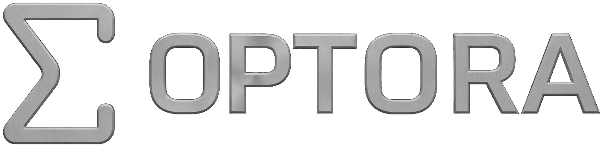

# Optora { .hero__title }

<div class="hero" markdown>

{ .hero__logo }

<p class="hero__tagline" markdown>
A small, composable PyTorch library for <b>distributionally robust
optimization</b>. Its ambiguity sets compute differentiable worst-case
expectations on any PyTorch device, and its minimax solver trains a
decision against them.
</p>

<div class="hero__actions" markdown>

[Get started :octicons-arrow-right-24:](#install){ .md-button .md-button--primary }
[:fontawesome-brands-github: Star on GitHub { .hero__star-count }](https://github.com/navidsharifi/optora){ .md-button }

</div>

</div>

<div class="badges" markdown>
[](https://pypi.org/project/optora/)
[](https://pypi.org/project/optora/)
[](https://github.com/navidsharifi/optora/blob/main/LICENSE)
[](https://github.com/navidsharifi/optora/actions/workflows/ci.yml)
[](https://github.com/navidsharifi/optora/actions/workflows/docs.yml)
[](https://doi.org/10.5281/zenodo.23850922)
</div>

<!-- optora-version-start -->
Latest release: `v0.2.0`
<!-- optora-version-end -->

## Overview

Empirical risk minimization fits the training distribution as it is.
Distributionally robust optimization instead minimizes the expected loss
under the *worst* distribution in a neighbourhood of the training
distribution,

$$
\min_x \; \sup_{q \,:\, D(q \,\|\, \mathrm{nominal}) \le \mathrm{radius}} \mathbb{E}_q[\ell(x, \xi)],
$$

where $D$ is a divergence between probability distributions. Optora splits
this problem into three composable classes. A `Divergence` is $D$. An
`AmbiguitySet` combines a divergence with a nominal distribution and a
radius and solves the inner supremum. A `Solver` minimizes over the
decision $x$. The worst-case expectation is an ordinary differentiable
PyTorch objective, so it can be used in any `nn.Module` and `torch.optim`
training loop. The derivations are in
[Mathematical formulations](formulations.md).

## In action

The first animation shows seven ambiguity sets with the same nominal
distribution (grey) and the same loss. In every frame each radius is the
same fraction of that set's saturation radius, and each geometry moves the
probability mass to different scenarios.

<figure class="figure" markdown="span">
  { loading=lazy }
  { loading=lazy }
  <figcaption>The worst-case distribution of every ambiguity set on the same
  twelve-scenario problem, read off autograd as the gradient of the
  worst-case expectation, as each ball grows to the radius at which it
  contains the point mass on the highest loss.</figcaption>
</figure>

<figure class="figure" markdown="span">
  { loading=lazy }
  { loading=lazy }
  <figcaption>The same sets on the probability simplex of a three-scenario
  problem. The shaded region is the ball around the nominal (grey dot), the
  trail is the path of the worst-case distribution, and the last panel shows
  the worst-case value.</figcaption>
</figure>

Every figure on this site is rendered from the library by
`python -m tools.figures` at build time, in both colour schemes. No figure
is drawn by hand, and no rendered figure is committed to the repository.

## Core components

<div class="grid cards" markdown>

-   :material-shape-outline:{ .lg .middle } __Core contracts__

    ---

    The abstract base classes `Solver`, `Divergence` and `AmbiguitySet`
    define what a new method subclasses. The module also holds
    device-resident convergence tracking and the working-dtype policy.

    [:octicons-arrow-right-24: `optora.core`](api/core/index.md)

-   :material-vector-triangle:{ .lg .middle } __Divergences__

    ---

    The module implements the Kullback-Leibler, general $\varphi$, $\chi^2$
    and total variation divergences, the max divergence, the Sinkhorn and
    entropic transport divergences, and the maximum mean discrepancy.

    [:octicons-arrow-right-24: `optora.divergences`](api/divergences/index.md)

-   :material-shield-half-full:{ .lg .middle } __Ambiguity sets__

    ---

    The module provides KL, $\varphi$, $\chi^2$, total variation, CVaR,
    Wasserstein, Sinkhorn and MMD balls on a finite support. Each one
    computes its worst case by a bracketed tilt, a closed form, a bisection
    or an interior-point cone program.

    [:octicons-arrow-right-24: `optora.dro`](api/dro/index.md)

-   :material-swap-vertical-bold:{ .lg .middle } __Minimax solve__

    ---

    `MinimaxSolver` combines any ambiguity set with an outer solver over the
    decision variable. By the envelope theorem the inner supremum is
    differentiable without unrolling the inner solve.

    [:octicons-arrow-right-24: `MinimaxSolver`](api/dro/minimax_solver.md)

-   :material-chart-timeline-variant:{ .lg .middle } __Solvers__

    ---

    The module provides fixed-step gradient descent and a primal-dual
    saddle-point solver. Both evaluate their stopping rule on the device
    and compose with `torch.func` transforms.

    [:octicons-arrow-right-24: `optora.solvers`](api/solvers/index.md)

-   :material-tune:{ .lg .middle } __Radius calibration__

    ---

    These functions turn a confidence level and a sample size into a KL,
    $\chi^2$, general $\varphi$ or Wasserstein radius. The robust value is
    then an asymptotically exact upper confidence bound on the true risk.

    [:octicons-arrow-right-24: `optora.dro.calibration`](api/dro/calibration.md)

-   :material-layers-triple-outline:{ .lg .middle } __Minibatch estimators__

    ---

    Two estimators target the population worst case from minibatches. The
    randomized multilevel Monte Carlo estimator removes the bias of the
    plug-in estimate up to its largest batch size, and the stochastic
    $\varphi$-dual has an unbiased minibatch mean.

    [:octicons-arrow-right-24: `optora.dro.minibatch`](api/dro/minibatch.md)

-   :material-account-group-outline:{ .lg .middle } __Group DRO__

    ---

    Train against the worst of several known groups, either exactly through
    an existing ambiguity set or online on minibatches with
    `OnlineGroupDRO`.

    [:octicons-arrow-right-24: `optora.dro.group_dro`](api/dro/group_dro.md)

-   :material-school-outline:{ .lg .middle } __Training__

    ---

    The worst case is a PyTorch loss with exact first and second
    derivatives with respect to the per-sample loss, the nominal and the
    radius.

    [:octicons-arrow-right-24: Training guide](training.md)

</div>

## Why Optora

<div class="grid cards" markdown>

-   :material-target:{ .lg .middle } __Robust by construction__

    ---

    Optimize against the worst case over an ambiguity set instead of trusting a
    single empirical distribution.

    [:octicons-arrow-right-24: Formulations](formulations.md)

-   :material-check-decagram:{ .lg .middle } __Exact inner solves__

    ---

    The default inner solves have no tolerance or step size to tune. Each
    ambiguity set reaches the precision of its working dtype, up to the
    exceptions documented on [Numerical behaviour](numerics.md), and the
    test suite checks it against independent linear-program, cone-program,
    closed-form or dual references.

    [:octicons-arrow-right-24: Benchmarks](benchmarks.md)

-   :material-speedometer:{ .lg .middle } __GPU-first__

    ---

    Every routine is vectorized PyTorch and batched over leading
    dimensions. The KL, $\chi^2$, total variation, CVaR, Wasserstein and
    Sinkhorn sets perform no host synchronization, and all tensor state
    moves with one `.to(device)` call.

-   :material-flask-outline:{ .lg .middle } __Verified numerics__

    ---

    The tests check property-based invariants, and they run `gradcheck` at
    smooth points and finite differences at kinks. Each dtype has a
    documented accuracy, and the benchmark suite fails CI on a performance
    regression.

    [:octicons-arrow-right-24: Numerical behaviour](numerics.md)

</div>

## Install

```bash
pip install optora
```

For local development, install the project in editable mode with the developer
and documentation extras.

```bash
pip install -e ".[dev,docs]"
```

## Quick start

The example below finds the decision $x$ that minimizes the worst-case
squared error over a KL ball of distributions on four observed outcomes.

```python
import torch
from optora import GradientDescent, KLAmbiguitySet, MinimaxProblem, MinimaxSolver

nominal = torch.tensor([0.25, 0.25, 0.25, 0.25])
outcomes = torch.tensor([1.0, 2.0, 3.0, 10.0])

problem = MinimaxProblem(
    ambiguity_set=KLAmbiguitySet(nominal=nominal, radius=0.1),
    loss_fn=lambda x: (outcomes - x) ** 2,
    initial_point=torch.tensor(0.0),
)
outer_solver = GradientDescent(step_size=0.01, max_iter=200, tol=1e-6)
robust_decision = MinimaxSolver(solver=outer_solver).solve(problem).point
```

To train an `nn.Module` instead, call `worst_case_expectation` on the
per-sample loss and step any `torch.optim` optimizer, as the
[training guide](training.md) shows.

## Imports

Every main class is re-exported from the package root, so the two forms below
name the same object.

```python
from optora import KLAmbiguitySet, MinimaxSolver
from optora.dro import KLAmbiguitySet, MinimaxSolver
```

The root exports only classes, namely the `Solver`, `Divergence` and
`AmbiguitySet` contracts, their implementations, the minibatch and group
estimators, and the problem and result types. Convergence diagnostics stay
in `optora.core`, and helper functions such as the radius calibrations stay
in the subpackage that defines them. There are no root-level workflow
functions, so an algorithm runs through `Solver.solve(problem)`.

## Build documentation

=== "Preview"

    ```bash
    python -m tools.figures   # render the figures once (optional)
    python -m tools.docs serve
    ```

=== "Production build"

    ```bash
    python -m tools.figures
    python -m tools.docs build
    ```

!!! tip "The API reference and the figures are generated"

    `tools.docs` discovers every public module under `optora/`, writes one page
    per module, and rewrites the API navigation. `tools.figures` renders every
    chart, animation and benchmark on the site from the library itself, in
    both colour schemes. Never edit the generated pages by hand, and never
    commit a rendered figure.

## Versioning

Optora is alpha software and follows Semantic Versioning. During `0.x` a
minor release may change the public API and a patch release does not.
[API stability](stability.md) defines what counts as public.

## Citing

If you use Optora in your research, please cite it. Every release is archived
on Zenodo under the concept DOI
[10.5281/zenodo.23850922](https://doi.org/10.5281/zenodo.23850922), which
always resolves to the latest version. The metadata is in
[`CITATION.cff`](https://github.com/navidsharifi/optora/blob/main/CITATION.cff),
which GitHub's "Cite this repository" button turns into APA or BibTeX.

## Contributing

The development workflow, coding style and pull request checklist are in
[`CONTRIBUTING.md`](https://github.com/navidsharifi/optora/blob/main/CONTRIBUTING.md).
If Optora is useful to you, a star on
[GitHub :fontawesome-brands-github:](https://github.com/navidsharifi/optora)
helps other researchers find it.
